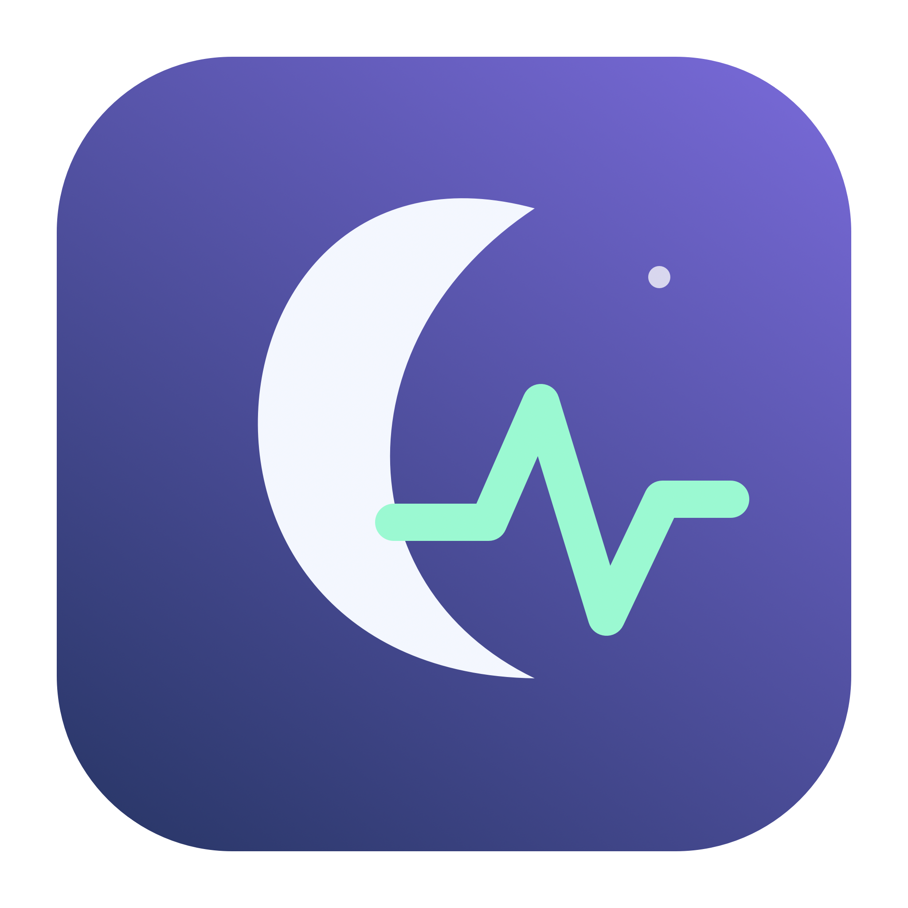
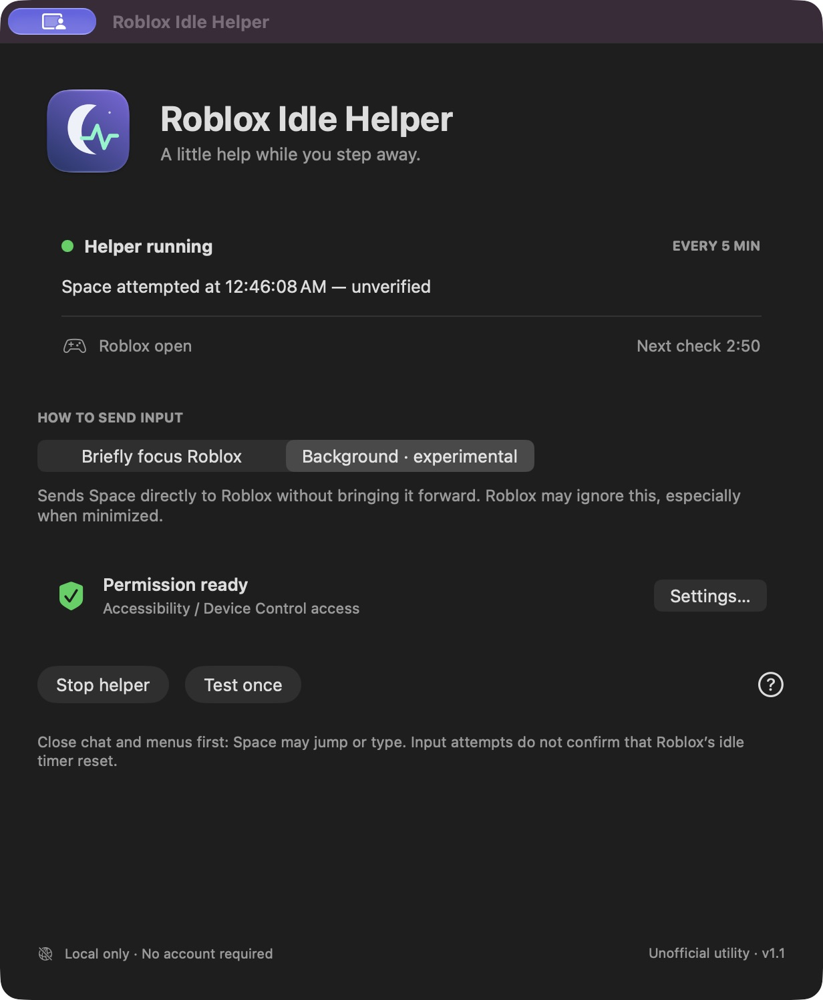
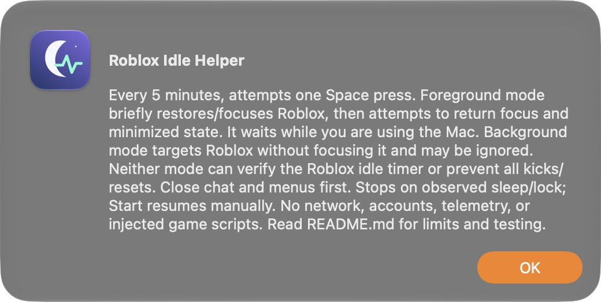

<div align="center">
  
  <h1>Roblox Idle Helper</h1>
  <p>A small, local macOS utility for the moments you step away.</p>
  <p><strong>Native Mac app · Two input modes · No account required</strong></p>
  <p>
    <a href="https://github.com/timmyv23/Roblox-ANTI-afk-MacOS-/releases/tag/v1.1.0"><strong>Download v1.1.0</strong></a>
    &nbsp;·&nbsp; <a href="GUIDE.md">Setup guide</a>
    &nbsp;·&nbsp; <a href="VALIDATION.md">Testing record</a>
    &nbsp;·&nbsp; <a href="https://github.com/timmyv23/Roblox-ANTI-afk-MacOS-/issues">Report an issue</a>
  </p>
</div>

> [!IMPORTANT]
> **Experimental prerelease.** This app attempts input; it cannot confirm that Roblox resets its idle timer. Background and minimized operation may be ignored. It does not guarantee prevention of idle kicks, server resets, or experience-specific AFK rules.

## Meet the app

<p align="center">
  
</p>
<p align="center"><em>Actual application screenshot, captured on macOS. “Space attempted” reports an input attempt, not verified idle protection.</em></p>

## What’s inside

| Feature | What you get |
| :--- | :--- |
| **A proper Mac app** | Native window, custom Dock icon, and a menu-bar shortcut. |
| **Two input modes** | Briefly focus Roblox, or try process-targeted background input. |
| **Simple controls** | Start, Stop, and a one-shot test before committing to a session. |
| **Visible status** | Permission readiness, Roblox detection, and the next scheduled check. |
| **Five-minute schedule** | Attempts a short Space press; foreground mode defers while you use the Mac. |
| **Local operation** | No network requests, analytics, account login, or game modifications. |

## Get started

1. **[Download the app ZIP](https://github.com/timmyv23/Roblox-ANTI-afk-MacOS-/releases/download/v1.1.0/RobloxIdleHelper.zip)** and unzip it.
2. Move **Roblox Idle Helper.app** to Applications, then open it.
3. Use **Set up…** to enable Accessibility access in System Settings. On newer macOS versions this may be named **Device Control and Data Access**.
4. Open Roblox, join an experience, and close chat and menus. Choose somewhere a **Space press/jump is harmless**.
5. Choose a mode and click **Test once**. In foreground mode, leave the keyboard and mouse alone for at least 10 seconds so the test can proceed.
6. Click **Start helper** to enable the five-minute schedule. Use **Stop helper** to pause, or quit from the app menu.

**Download compatibility:** the included app is for **Apple Silicon**, targeting **macOS 12+**. It was built and checked on macOS 27.0.1; older systems are untested. Intel users can [build locally](GUIDE.md#build-locally-no-developer-account-or-notarization).

**Local signing:** the app is ad-hoc signed, **not notarized**. macOS may block a downloaded copy. See the [setup guide](GUIDE.md#build-locally-no-developer-account-or-notarization) for local build and per-app opening instructions; no Apple developer membership is needed.

## Pick your mode

| | Briefly focus Roblox | Background · experimental |
| :--- | :--- | :--- |
| **Focus** | Briefly brings Roblox forward. | Leaves your current app in front. |
| **Minimized window** | Attempts to restore it, send input, then restore its prior state. | Remains minimized; Roblox may ignore the input. |
| **While you work** | Defers during keyboard/mouse activity. | Sends directly to Roblox’s process when its held-control checks pass. |
| **Tradeoff** | More promising, but interrupts the screen and can defer too long. | Less disruptive, but acceptance by Roblox is unverified. |

Neither mode automatically falls back to the other. Changing mode stops the schedule until you press Start again.

## Transparent by design

The interface says **unverified** because the utility does not inspect Roblox’s memory, server state, or idle timer. A successful event-posting attempt is not proof that Roblox accepted it.

- Build, code-signature, and local control checks passed.
- A one-shot background test reached the event-posting path and stopped automatically.
- **No completed 25–30 minute idle-prevention trial has established effectiveness.** Follow the [test procedure](GUIDE.md#verify-on-your-own-setup) on your own setup.

<details>
<summary><strong>See the actual in-app explanation</strong></summary>
<br>

</details>

## A few things to know

- **Space can jump, type, or activate a control.** Close text fields and menus first.
- **Accessibility is a broad permission.** The code is available to review; revoke access when you no longer need it.
- **Foreground focus checks are not atomic.** A last-moment focus switch can send Space to another app.
- **The helper keeps ordinary idle display/system sleep at bay while running.** This uses more power; it does not prevent lid-close or manual sleep. Stop before locking or leaving the machine. Observed lock/sleep events stop scheduling, but detection is best-effort.
- Use only where automation is permitted. This is an **unofficial utility**, not affiliated with or endorsed by Roblox.

## Build from source

Install Apple Command Line Tools with `xcode-select --install`, download the source, and run this from its folder:

```sh
/bin/zsh ./build.command
```

To run the local checks without sending keyboard input:

```sh
/bin/zsh ./check.command
```

The build uses Swift and Apple’s SDKs, with no third-party packages. See the [full guide](GUIDE.md) for setup, troubleshooting, privacy details, and research sources.

## Feedback

[Open an issue](https://github.com/timmyv23/Roblox-ANTI-afk-MacOS-/issues) with your macOS version, Mac chip, selected mode, whether Roblox was minimized, and the exact status shown. For an idle-disconnect report, include how long the trial ran and whether you manually interacted with Roblox. Please leave out account credentials or personal information.
